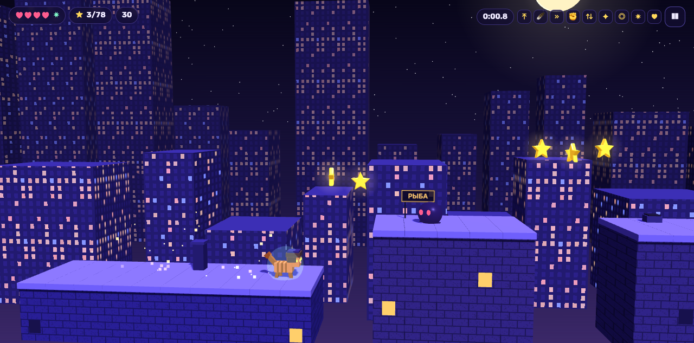
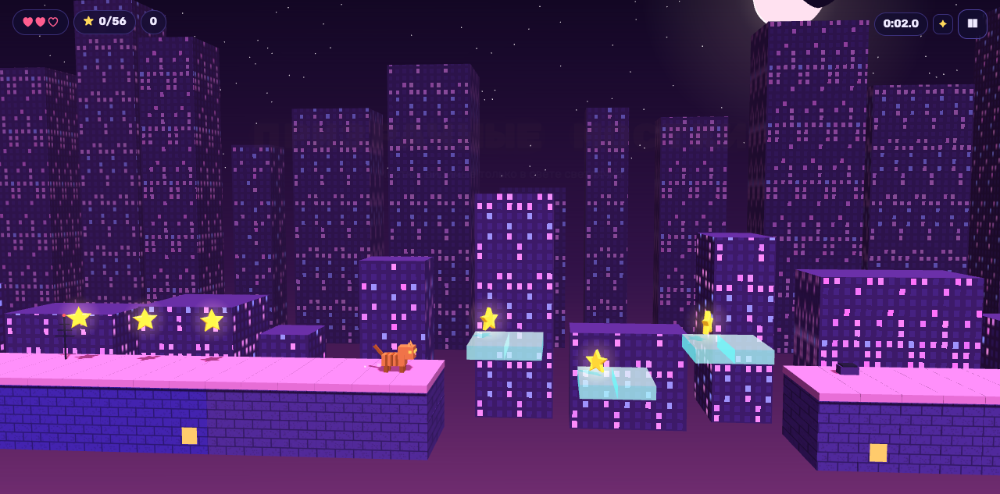
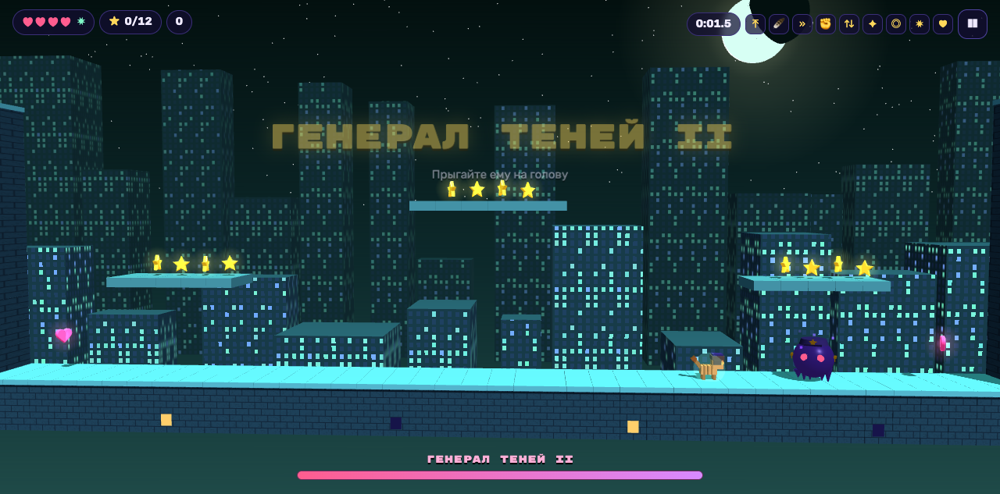
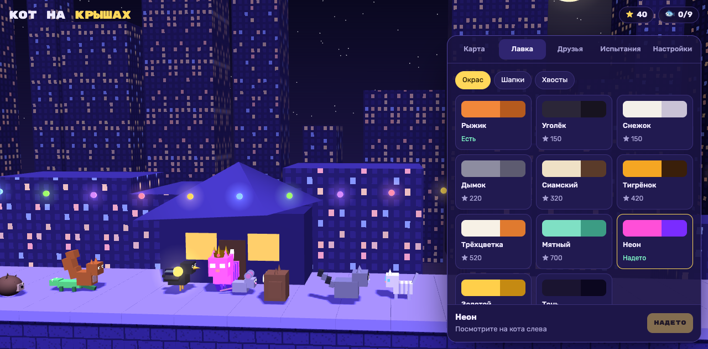
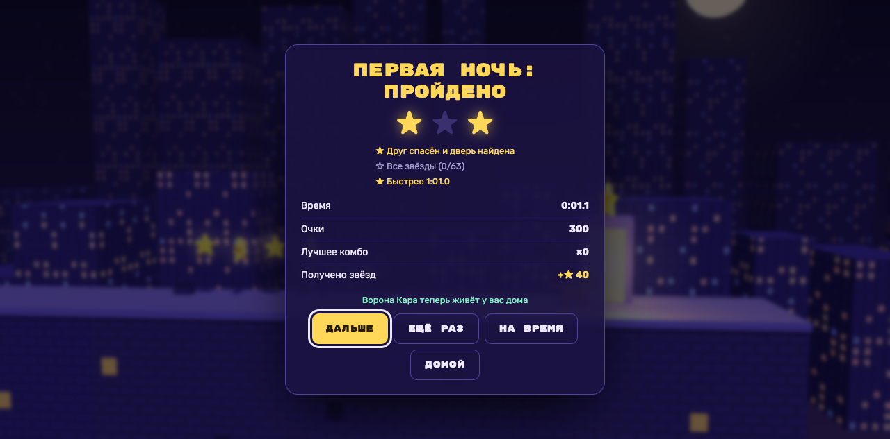
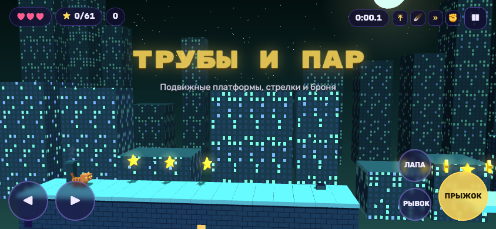

# Кот на крышах

Ночной 3D-платформер. Король Теней запер друзей кота в клетках на крышах города. Нужно спасти всех, научиться новому и победить Короля.

| | |
|---|---|
|  |  |
|  |  |
|  |  |

**Как запустить:** откройте `index.html` в браузере. Всё лежит в папке, интернет не нужен (шрифты подгружаются из сети, без них игра тоже работает). Чтобы игра установилась как приложение (PWA), её надо открыть по `http(s)://`: `python3 -m http.server`, затем `http://localhost:8000`.

## Сюжет

Король Теней похитил друзей кота, запер их в клетках и спрятал ключи. По следу кота он пустил своего пса. Сначала кот бежит по ночному городу: старые крыши, потом фабричные трубы. Затем он спускается в берлогу Короля под городом.

- **Спрятанные вещи.** Клетку открывают ключи, верёвки (подвешенная клетка опускается) и кусачки (рвут цепи). С каждым уровнем их нужно больше: от 1 ключа на первом уровне до 8 вещей в Тронном зале. Если кот добежал до клетки без всего нужного, придётся возвращаться и искать, а пёс никуда не делся.
- **Пёс бежит точно по следу кота.** Стоишь на месте — он догоняет. С каждым уровнем он быстрее. В каждом мире у пса новый облик: Тень-пёс, Железный пёс с рывками, трёхголовый Цербер Короля.
- **Ловушки.** Клавиша C или кнопка 🪤. На каждом уровне новая ловушка, и каждая следующая сильнее: клубок ниток, банановая кожура, мышеловка, мёд, сеть, капкан, петарда, ледяная ловушка, звёздная клетка. Ловушки ловят и обычных теней. Дополнительные ловушки лежат в наборах 🧰.
- **Берлога.** Пещерный фон с кристаллами и сталактитами, каменный свод. Свои испытания: падающие сталактиты, липкая слизь (медленнее и ниже прыжок), огненные гейзеры теней и тёмные зоны, где видно только круг вокруг кота (со светлячком круг больше).
- **Комикс-сцены** в начале игры, перед фабриками и у входа в берлогу.

## Что в игре

- **12 уровней в 3 мирах.** На каждом обычном уровне вы спасаете друга, и он даёт новое умение: двойной прыжок, планирование, перекат, удар лапой, прыжок от стен, свет светлячка, звёздный магнит, щит и четвёртое сердце.
- **Секреты.** На каждом уровне спрятана золотая рыбка, до которой можно добраться только с умением из более поздних уровней. Если собрать все рыбки, откроется золотой окрас.
- **Боссы.** Генерал теней дважды и Король Теней в финале. У каждого есть фазы и броня.
- **Враги:** тень, прыгающая тень, летучая мышь, стреляющая тень и бронированная тень.
- **Препятствия:** движущиеся платформы и лифты, падающая черепица, пружины, ветер, восходящие потоки, треснувшие стены и призрачные мостки.
- **Сочность:** весь звук и музыка синтезируются в коде, у каждого мира свой трек. Есть пыль, искры, тряска камеры, заморозка кадра при ударе и комбо до ×8.
- **Прогресс:** карта мира, три оценки за уровень (пройти, собрать все звёзды, уложиться в норматив), лавка скинов за звёзды (окрасы, шапки, хвосты) и дом на крыше, где живут спасённые друзья.
- **Чтобы играть ещё:** испытание дня (один уровень на всех, результатом можно поделиться), бесконечный режим, режим на время с призраком лучшего забега, поддержка геймпада.
- **Публикация:** PWA с офлайн-кэшем, интеграция с Telegram Mini App (вибрация и кнопка «поделиться»), скрипт `build-itch.sh` собирает zip для itch.io.

## Управление

| Действие | Клавиатура | Геймпад |
|---|---|---|
| Бег | ← → / A D | стик, крестовина |
| Прыжок, планирование (удерживать) | Пробел / W / ↑ | A |
| Перекат | Shift / J | B, RB |
| Удар лапой | X / K | X, LB |
| Ловушка для пса | C / E | Y |
| Пауза · заново · музыка | P · R · M | Start |

На телефоне управление показывается кнопками прямо на экране.

## Устройство кода

```
index.html        разметка и стили
js/data.js        друзья, умения, скины, миры
js/levels.js      генератор уровней из кусков, кампания, испытания
js/core.js        физика и логика без DOM: враги, боссы, события
js/audio.js       синтез звука и музыкальный секвенсор (WebAudio)
js/render.js      3D-сцена (three.js r128 в vendor/)
js/ui.js          меню, HUD, экраны
js/main.js        сохранения, ход игры, ввод, PWA, Telegram
sw.js, manifest.webmanifest, icons/
2d/               старая пиксельная 2D-версия
```

## Публикация

**GitHub Pages** (бесплатная ссылка на игру): Settings → Pages → Source: *Deploy from a branch*, Branch: `main`, папка `/ (root)` → Save. Через минуту игра будет на `https://malikahay.github.io/kot-na-krishax/`. На этом адресе работает установка как приложение и офлайн-режим.

**itch.io:** запустите `./build-itch.sh`. На itch.io выберите *Upload new project* → Kind: *HTML*, загрузите `kot-na-kryshah-itch.zip`, отметьте *This file will be played in the browser*. Размер окна поставьте 1280×720 и включите кнопку полноэкранного режима. Обложка лежит в `icons/cover-630x500.png`.

**Telegram Mini App:** в @BotFather выполните `/newbot`, затем `/newapp` (или *Bot Settings → Menu Button*) и укажите ссылку с GitHub Pages. Внутри Telegram игра сама включает вибрацию и делится результатами через Telegram.

**Яндекс Игры:** загрузите тот же zip в консоль разработчика. SDK (`/sdk.js`) подключается автоматически, только на площадке Яндекса. Игра сообщает площадке о загрузке, а также о старте и паузе игрового процесса.

## Проверка

Бот с поиском пути проходит все 12 уровней и процедурные испытания, используя только те умения, которые у игрока к этому моменту уже есть.
